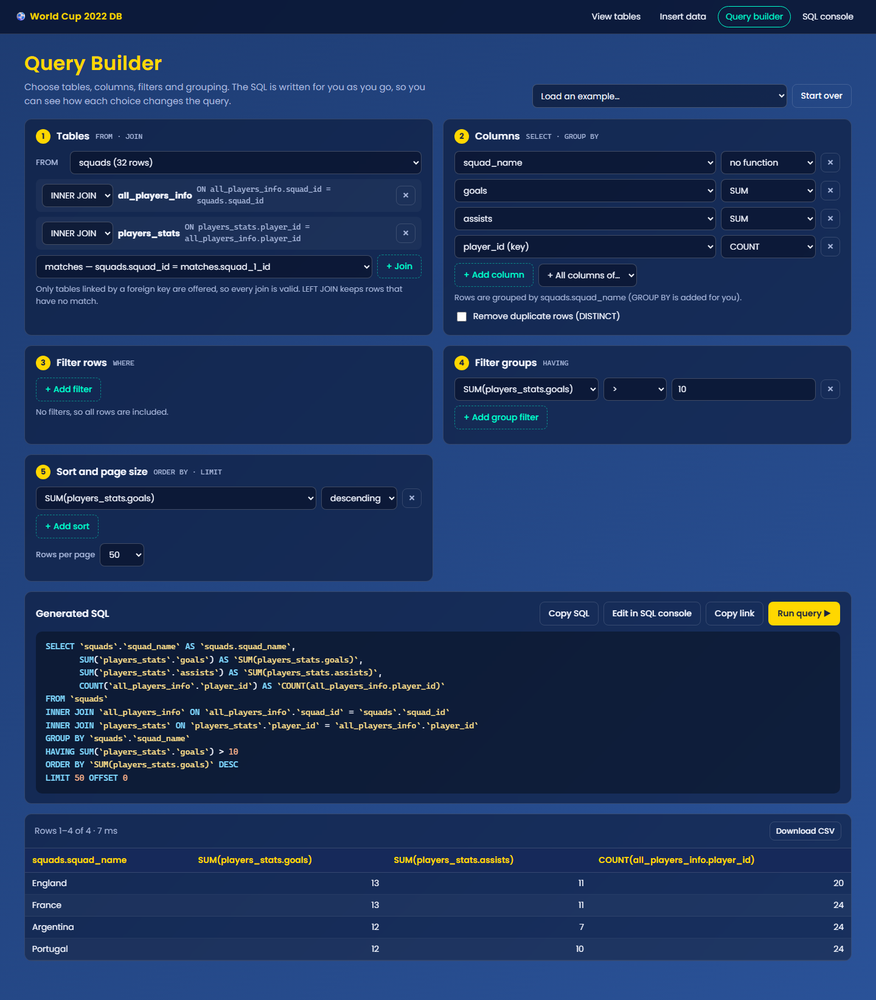
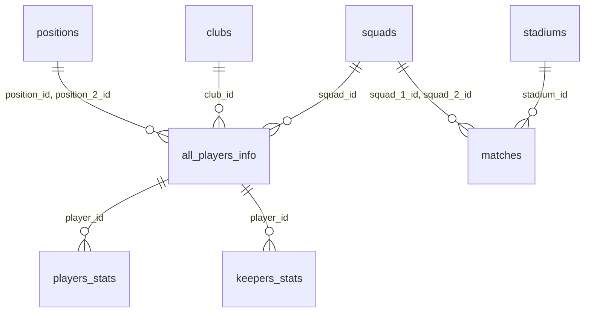
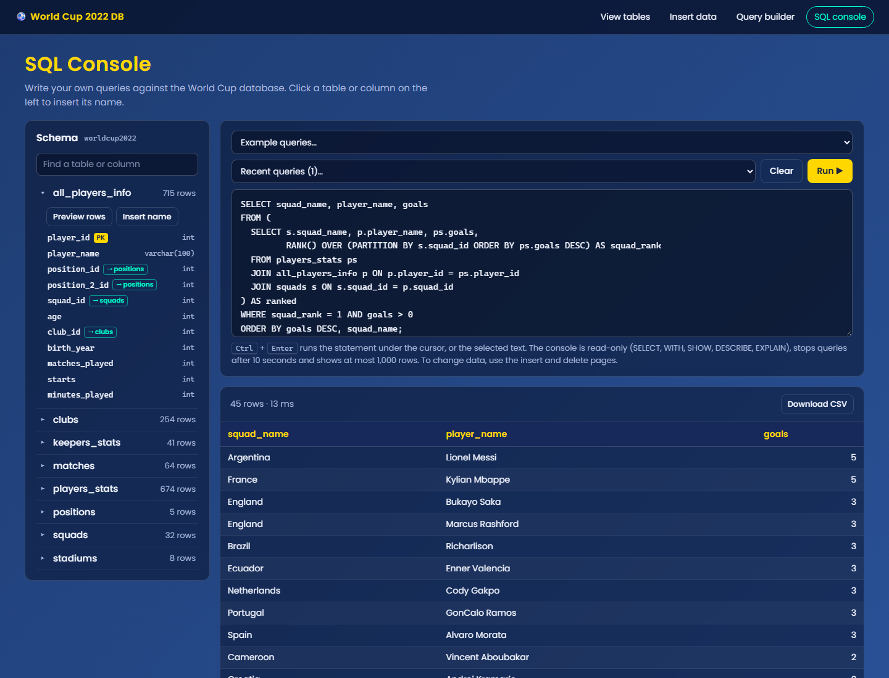
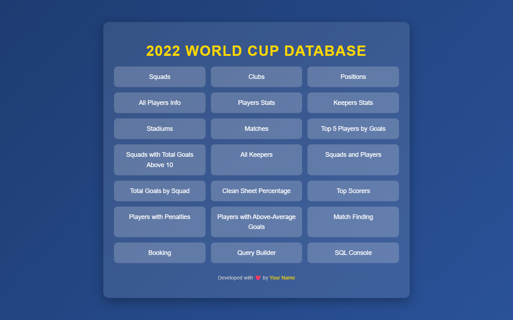
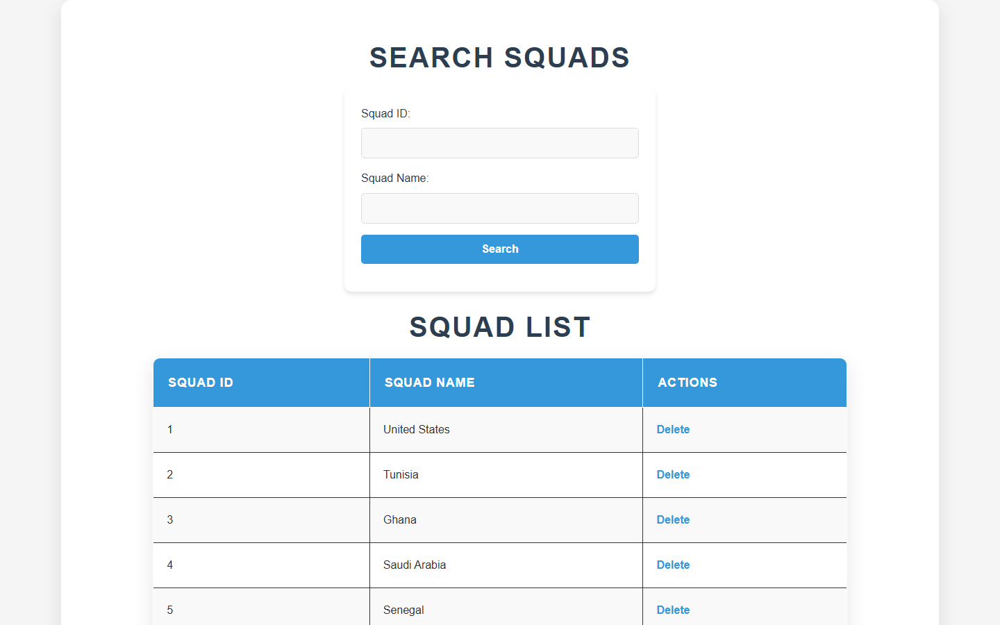
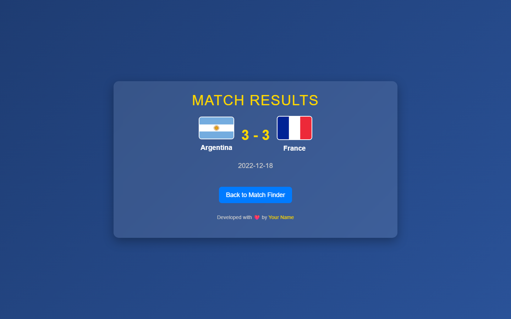
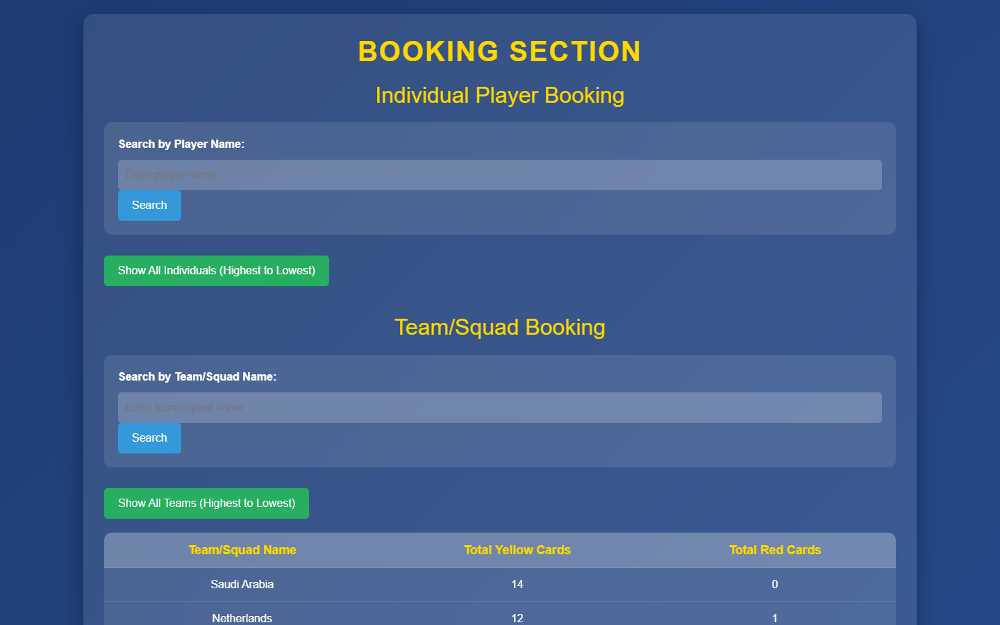
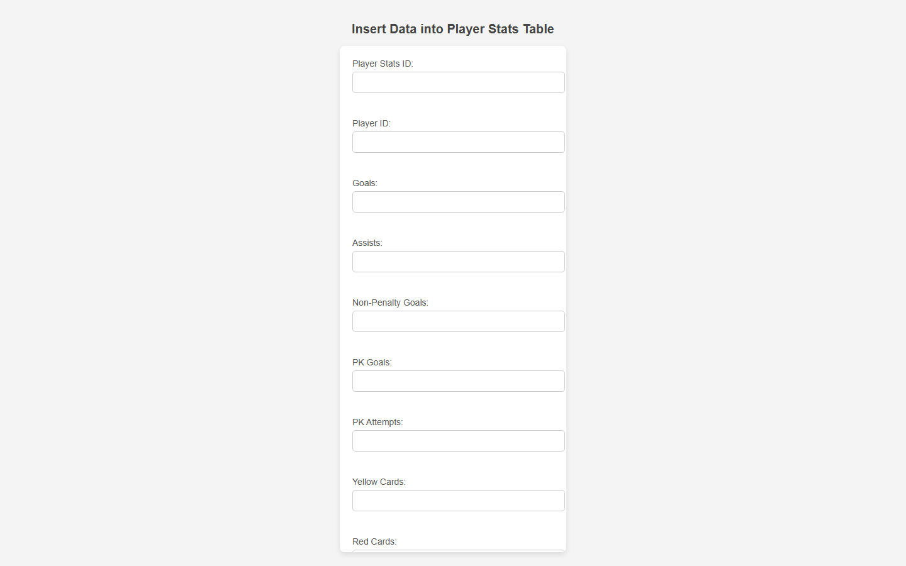

# ⚽ FIFA World Cup 2022 Database

A full-stack DBMS project: a relational MySQL database of the 2022 World Cup (8 tables, 1,793 rows) and a Node.js + Express web app to browse, edit and query it, including a **visual query builder** and a **read-only SQL console**.



## Features

- **Browse and search** all 8 tables, with live search and delete.
- **Insert forms** for every table; primary and foreign keys are enforced by MySQL.
- **12 SQL reports**: top scorers, squad goal totals, clean-sheet percentage, bookings, a head-to-head match finder with flags, and more. They cover JOINs, GROUP BY / HAVING, subqueries, EXISTS and CTEs.
- **Visual query builder**: pick a table, join related tables along foreign keys, add COUNT/SUM/AVG/MIN/MAX, filter rows (WHERE) and groups (HAVING), sort and page. The SQL is generated live, and every query can be shared as a link or exported to CSV.
- **SQL console**: write your own queries with a clickable schema browser, 13 example queries (window functions, UNION ALL, EXPLAIN and more), query history and CSV export.
- **Safe by design**: all values are sent as query parameters, and builder table/column names are checked against `information_schema`. The console only accepts read-only statements and runs them in a `READ ONLY` transaction, with a 10-second timeout and a 1,000-row cap.

## Tech stack

| Layer | Tools |
| --- | --- |
| Database | MySQL 8.0 |
| Backend | Node.js 20.12+, Express 4, mysql2 |
| Frontend | EJS templates, HTML, CSS, vanilla JavaScript |
| Dev | nodemon |

## Database



| Table | Rows | Contents |
| --- | ---: | --- |
| `squads` | 32 | National teams |
| `clubs` | 254 | Players' clubs |
| `positions` | 5 | MF, DF, FW, GK, NO DATA |
| `stadiums` | 8 | Venue, capacity, matches hosted |
| `all_players_info` | 715 | Player profile, squad, club, positions, minutes |
| `players_stats` | 674 | Goals, assists, penalties, cards |
| `keepers_stats` | 41 | Saves, clean sheets, penalties faced |
| `matches` | 64 | Date, stadium, both squads and scores |

`database/worldcup2022.sql` creates the database with all tables, keys and data. The source CSVs are in `database/csv/`.

## Getting started

Requires **Node.js 20.12+** and **MySQL 8.0**. Tested with Node.js 22.13 and MySQL 8.0.46 on Windows 11.

```bash
# 1. Get the code and install dependencies
git clone <your-repo-url>
cd <repo-folder>
npm install

# 2. Create the database (or open the file in MySQL Workbench and run it)
mysql -u root -p -e "source database/worldcup2022.sql"

# 3. Add your MySQL login
cp .env.example .env        # Windows: copy .env.example .env
#    then set DB_PASSWORD (and DB_USER if not root) in .env

# 4. Start the app
npm start                   # or: npm run dev (restarts on file changes)
```

Open **http://localhost:9000**. The console should print `Connected to MySQL database`. If you see "Access denied" instead, check the login in `.env`.

If the terminal says `mysql` is not recognized, MySQL's `bin` folder is not on your PATH. Either add it (on Windows usually `C:\Program Files\MySQL\MySQL Server 8.0\bin`) or create the database in MySQL Workbench: **File → Open SQL Script**, pick `database/worldcup2022.sql`, then click the lightning-bolt button to run it.

| Setting (`.env`) | Default |
| --- | --- |
| `DB_HOST` | `localhost` |
| `DB_USER` | `root` |
| `DB_PASSWORD` | *(empty)* |
| `DB_NAME` | `worldcup2022` |
| `PORT` | `9000` |

## Project structure

```
├── server/            App entry point, MySQL connection pool, schema reader
├── routes/            View, insert, delete, search, and query builder / console routes
├── views/             EJS templates for table lists and reports
├── pages/             Static pages: menus, query builder, SQL console
│   └── insert_forms/  One insert form per table
├── public/            CSS, client-side JavaScript, images (country flags)
├── database/          worldcup2022.sql and source CSVs
└── screenshots/       Images used in this README
```

## Screenshots

| | |
| --- | --- |
|  SQL console |  Tables and reports menu |
|  Table view with live search |  Head-to-head match finder |
|  Bookings report |  Insert form |

<details>
<summary>All pages</summary>

**Menus**: [Home](screenshots/home.png) · [Tables and reports](screenshots/view_tables.png) · [Insert menu](screenshots/insert_tables.png)

**Tables**: [squads](screenshots/table_squads.png) · [clubs](screenshots/table_clubs.png) · [positions](screenshots/table_positions.png) · [all_players_info](screenshots/table_all_players_info.png) · [players_stats](screenshots/table_players_stats.png) · [keepers_stats](screenshots/table_keepers_stats.png) · [stadiums](screenshots/table_stadiums.png) · [matches](screenshots/table_matches.png)

**Reports**: [Top players](screenshots/report_top_players.png) · [Squads above 10 goals](screenshots/report_squads_with_high_goals.png) · [Keepers](screenshots/report_keepers.png) · [Squads and players](screenshots/report_squads_and_players.png) · [Goals by squad](screenshots/report_squad_goals.png) · [Clean-sheet %](screenshots/report_clean_sheet_percentage.png) · [Top scorers](screenshots/report_top_scorers.png) · [Penalties](screenshots/report_players_with_penalties.png) · [Above-average scorers](screenshots/report_above_average_goals.png) · [Match finder](screenshots/report_match_finder.png) · [Match result](screenshots/report_match_results.png) · [Bookings](screenshots/report_booking.png)

**Insert forms**: [squads](screenshots/insert_squads.png) · [clubs](screenshots/insert_clubs.png) · [positions](screenshots/insert_positions.png) · [all_players_info](screenshots/insert_all_players_info.png) · [players_stats](screenshots/insert_players_stats.png) · [keepers_stats](screenshots/insert_keepers_stats.png) · [stadiums](screenshots/insert_stadiums.png) · [matches](screenshots/insert_matches.png)

**Query tools**: [Query builder](screenshots/query_builder.png) · [SQL console](screenshots/sql_console.png)

</details>

## Contact
**Tawyabul Islam Tamim**

Email: [tawyabulislamtamim@gmail.com](mailto:tawyabulislamtamim@gmail.com)
